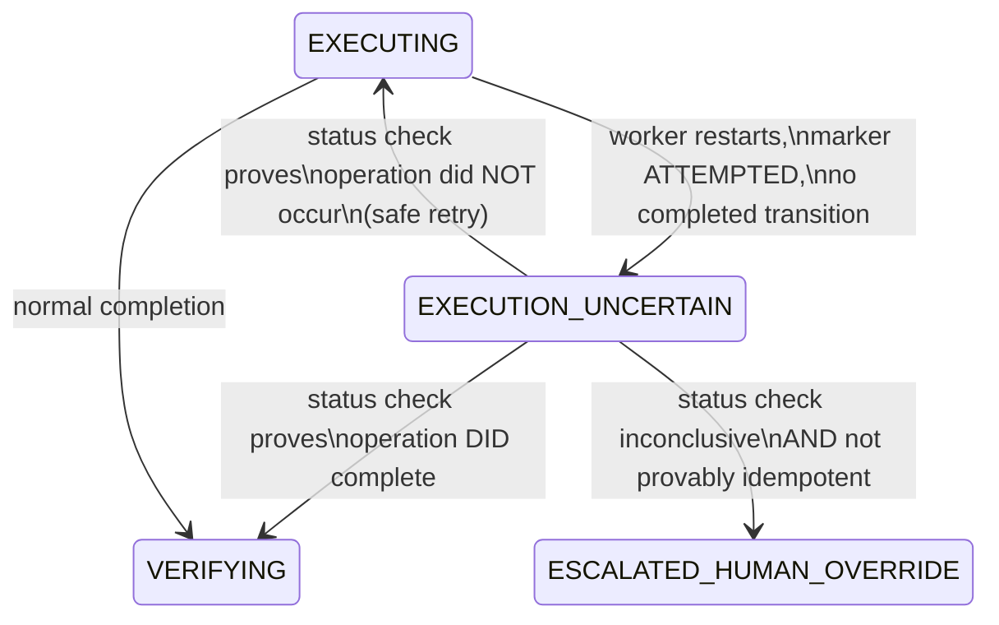
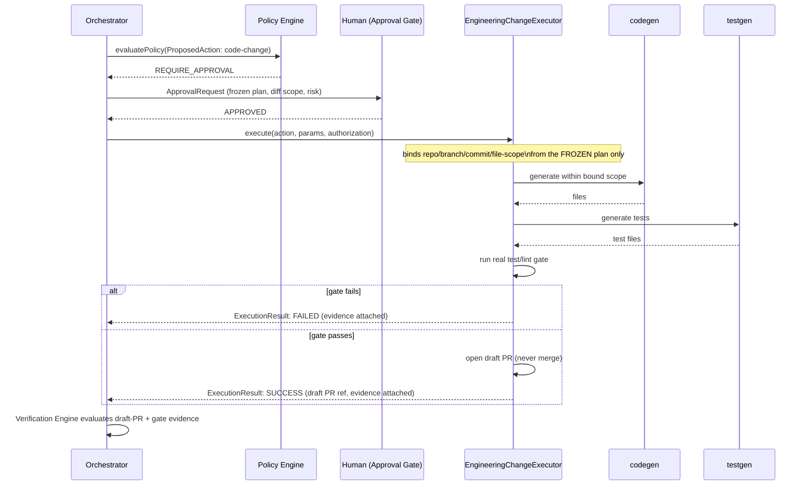
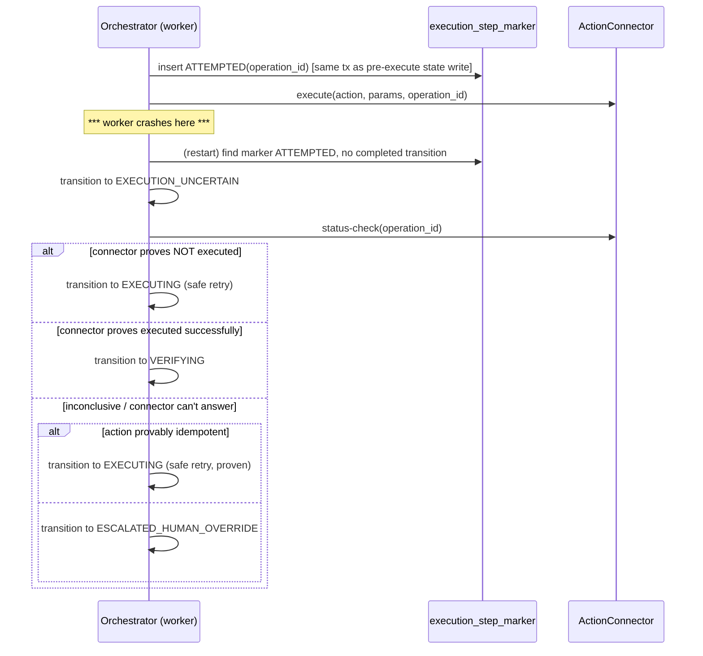

# LLD v1 — AOP-001

**Phase:** 2 (Design) · **Agent:** lld · **Status:** awaiting HIL gate
**Inputs:** 12 `ACCEPTED` ADRs (`pipeline/adr/`), `pipeline/requirements.md`
(Revision 2), spec §32's entity inventory. Only **additive** changes to
spec-defined contracts throughout, per ADR-001's established convention —
nothing here renames or removes a spec-literal field; extensions are new
fields or new tables.

---

## 0. Decision queue carried from ADR — resolved here

Per direction, OI-REQ-02 and OI-REQ-10 (LLD-blocking, not ADR-blocking) are
resolved in this document, the same way the 12 ADR-blocking items were
resolved in Phase 2's ADR stage.

### OI-REQ-02 — `ContextPackage` shape

**Decision:** No schema change to `ContextPackage`. `Execution History` and
`Evaluation Results` (the vision doc's "Engineering Context Package"
fields) are served as a **derived, read-only composite view** —
`EngineeringContextPackageView` — assembled at read time by joining
`ContextPackage` + `ExecutionState` history + `VerificationResult`, keyed by
`execution_id`. This mirrors the spec's own existing pattern: `Evidence`
relationships are join-based (§4.6), not embedded — the composite view
follows the same discipline rather than introducing a new one.
**Consequence:** `apps/api` gains a read endpoint producing this view (§6);
zero migration on `context_package`.

### OI-REQ-10 — version-binding fields

**Decision:** two new fields, both additive:
- `connector_definition.definition_version: string` — formalizes the
  version concept ADR-007 already assumes.
- `action_execution.executor_build_hash: string` — populated by
  `apps/worker` from a build-time-injected constant (container image's git
  SHA, read from an env var/manifest at startup — never computed at
  runtime, which would defeat the point of a build hash).

Combined with fields that **already exist** (per F-20's own table:
`opc_version`, `action_version`, `policy_version`, `plan_id`,
`approval_id`, `generated_by`), every execution can now be fully
version-bound with no further schema work.

---

## 1. ADR consequences carried into LLD constraints (mechanical gate 3)

Every ADR "(–)" consequence that requires real implementation, mapped to
where it's addressed in this LLD or flagged for Build:

| ADR | Consequence requiring follow-through | LLD constraint |
|---|---|---|
| 001 | Two fields (`reversible`/`compensation_class`) must stay consistent | `ActionConnector.validateAction()` runs the consistency check — Build story requirement, tested by `test_actionDefinition_rejectsInconsistentReversibleAndCompensationClass()` |
| 001 | `rollback_action_ref` means different things per class | Documented per-class in the Zod schema JSDoc (§2) |
| 002 | Self-heal/real-test-gate logic must be shared, not duplicated | A shared `runRealTestGate()` module (packages location TBD at Build time) used by both the full Build loop and `EngineeringChangeExecutor` |
| 002 | Two orchestration paths need consistency tests | A shared contract test suite exercising both paths against the same fixture |
| 003 | Declarative rules less expressive than executable code | Rule-language grammar scoped explicitly in §3 below, not left implicit — its limits are known now, not discovered mid-Build |
| 004 | `ActionConnector` needs an explicit idempotency contract per connector | `connector_definition` gains `supports_correlation` + `is_idempotent` booleans (§2), required at registration |
| 004 | Marker needs a durability guarantee | Same-transaction write into `execution_step_marker` (§2), consistent with ADR-005's pattern |
| 005 | Outbox relay is a new operational component | Flagged for a dedicated Build story + a relay-lag metric extending spec §29's observability set |
| 005 | Event consumers must tolerate at-least-once delivery | Control Tower's event consumption dedupes by `event_id` — a stated Build requirement, not assumed |
| 006 | `VerificationResult.checks[].name` needs a formal enum | Enum defined in §2, including `ROLE_SEPARATED_REVIEW` |
| 007 | More configuration surface (per-connector-instance reliability) | Registry shape defined in §2 |
| 008 | Policy Engine's evaluation-failure path needs explicit fail-closed behavior | Two-phase evaluation design, §3 |
| 008 | Hard-deny list must be enforced before approval-routing | Same design, §3 — ordering is structural, not a convention |
| 011 | Five retention classes need real default values | Defined in §2 |
| 011 | "Mandatory tenant decision before production onboarding" needs technical enforcement, not just documentation | Tenant activation gate, §2/§6 |
| 012 | More MVP-scope work than Revision 1 implied | `identity_principal` table + `IdentityResolver` interface, §2/§4 |
| 012 | Dev principals must be clearly labeled non-production | `is_development_principal` flag + activation-gate check (unified with 011's gate) |

(ADRs 009, 010 carried no outstanding "(–)" requiring new LLD design beyond
what they already specified — their interfaces are referenced in §5.)

---

## 2. Data model deltas

Additive only, against spec §32's table list. Tables/fields not mentioned
here are unchanged from spec.

### New tables

```
execution_step_marker      -- ADR-004 write-ahead marker
  id, execution_id, step_id, operation_id, status (ATTEMPTED|COMPLETED),
  created_at, connector_ref
  -- written in the same transaction as the "about to execute" state
  -- transition, BEFORE the connector call; updated to COMPLETED after.

outbox_event                -- ADR-005
  id, execution_id, event_type, payload, created_at,
  delivered_at?, delivery_attempts
  -- inserted in the SAME transaction as the execution/evidence write it
  -- accompanies; a separate relay process publishes and marks delivered.

identity_principal           -- ADR-012
  id, tenant_id, display_name, roles: string[],
  is_development_principal: boolean, created_at
```

### Changed tables (additive fields only)

| Table | New field(s) | Why |
|---|---|---|
| `action_definition` | `compensation_class: REVERSIBLE\|COMPENSATABLE\|IRREVERSIBLE`, `risk_scoring_ref: string?` | ADR-001, ADR-003 |
| `proposed_action` | `risk_assessment.blast_radius` gains `environmental_criticality`, `compensation_class`, `data_sensitivity`, `customer_exposure` (JSON sub-fields alongside existing `scope`/`estimated_entities`) | ADR-003. **Design choice**: a JSON column, not a new table — these five components are always read/written together per proposal, no independent query pattern justifies normalizing them out yet. |
| `action_execution` | `executor_build_hash: string` | OI-REQ-10 |
| `connector_definition` | `definition_version: string`, `supports_correlation: boolean`, `is_idempotent: boolean` (the latter two apply to action/write connectors) | OI-REQ-10, ADR-004 |
| `execution` | `state` enum gains `EXECUTION_UNCERTAIN` | ADR-004 / gate 5, see §4 |
| `evidence` | `retention_class` constrained to 5 named values (`operational_state`, `prompts`, `evidence_record`, `secrets_redacted_payload`, `audit_hash`) each with a finite dev-default expiry | ADR-011 |
| `policy_decision` | `hard_deny_reason: string?` (populated only when `outcome: DENY` originates from the fixed hard-deny list, not a tenant rule) | ADR-008 / gate 4, see §3 |
| `tenant` | `retention_policy_confirmed_at: timestamp?`, `production_activated_at: timestamp?` | ADR-011, unified activation gate |

### Enums newly formalized

```
VerificationResult.checks[].name (ADR-006):
  UNIT_TEST | INTEGRATION_TEST | STATIC_ANALYSIS | POLICY_CHECK |
  ROLE_SEPARATED_REVIEW | PRODUCTION_EVIDENCE | PREFLIGHT_DRIFT_CHECK

connector reliability (ADR-007), keyed (tenant_id, connector_definition_ref,
connector_version):
  LOW | MEDIUM | HIGH | AUTHORITATIVE
```

---

## 3. Gate 4 — ADR-008 hard-deny rules as non-bypassable invariants

Policy evaluation is structurally two-phase, not a single rule pass:

```
evaluatePolicy(proposedAction):
  # PHASE 1 — fixed, non-tenant-configurable, cannot be skipped
  for check in HARD_DENY_CHECKS:        # the 7 conditions from ADR-008
    if check.fails(proposedAction):
      return DENY(hard_deny_reason: check.name)

  # PHASE 2 — tenant PolicyRule evaluation (spec §16), unchanged
  ...evaluate tenant rules, ALLOW | REQUIRE_APPROVAL | DENY...

  # evaluation failure at ANY point in either phase:
  on exception/timeout/malformed-rule/missing-input:
    return DENY(hard_deny_reason: "POLICY_EVALUATION_FAILED")
```

`HARD_DENY_CHECKS` is a **fixed list implemented in code**
(`packages/policy-engine/src/hard-deny.ts`), explicitly **not** loaded from
tenant config — no tenant policy authoring mistake or omission can disable
it, because it isn't reachable from config at all. This is the literal
mechanism that makes "non-bypassable" true rather than aspirational.

**Required test** (critical-invariant convention, `loop/agents/testgen.md`):
`test_hardDeny_cannotBeOverriddenByAnyPolicyRule()` — construct a tenant
policy config that tries to `ALLOW` an unregistered action; assert the
engine still returns `DENY` with the correct `hard_deny_reason`, regardless
of what Phase 2 would have decided.

---

## 4. Gate 5 — ADR-004's uncertain-outcome state, explicit in the execution-state model

Spec §7's `ExecutionState.state` enum gains one value:

```
... | EXECUTING | EXECUTION_UNCERTAIN | VERIFYING | ...
```



The only three valid exits from `EXECUTION_UNCERTAIN` require a **proof**
(a successful status check result, or a positive idempotency proof) — there
is no default/timeout transition back to `EXECUTING` or `VERIFYING`. This is
the explicit representation the review asked for: uncertainty is a named,
visible state with named exits, not an implicit retry path.

---

## 5. Gate 6 — ADR-012 identity model supports proposer/approver attribution

`IdentityResolver` (interface, `SecretResolver`-pattern) resolves an actor
reference against `identity_principal`. Two distinct resolutions matter for
attribution:

- `ProposedAction` gains `accountable_principal_id` — resolved from
  `IncomingRequest.requester` (or an on-behalf-of context) via
  `IdentityResolver`. This is **distinct** from `generated_by.agent`/`model`
  (spec §4.3) — that's which AI agent generated the proposal;
  `accountable_principal_id` is which human/system principal it was raised
  on behalf of.
- `ApprovalDecision.actor` (spec §18) resolves through the same
  `IdentityResolver`, to the same `identity_principal` table.

**Separation-of-duties check**: `IdentityResolver.checkSeparation(proposerPrincipalId,
approverPrincipalId, policy)` — a new Policy Engine hook. A `PolicyRule` can
set `requires_proposer_approver_separation: true` (an addition to spec
§16's `PolicyRule` shape) for a given risk class; when set, the same
principal cannot both propose and approve — the Policy Engine's Phase 2
(§3 above) rejects self-approval as a `REQUIRE_APPROVAL`-blocking condition,
routed to a different approver.

This makes proposer/approver attribution real even for MVP's
`SERVICE_ACCOUNT`-mode simulated action: `accountable_principal_id` and
`ApprovalDecision.actor` are both populated from `identity_principal` from
day one, using development principals (ADR-012) — not deferred alongside
the external provider integration.

---

## 6. API contracts (deltas only — spec's existing endpoints unchanged)

```http
# Internal — orchestrator to connector, not tenant-facing
POST /internal/connectors/{connector_ref}/status-check
  body: { operation_id }
  -- ADR-004's mandatory status check on EXECUTION_UNCERTAIN

# New read endpoint — OI-REQ-02 resolution
GET /tenants/{tenantId}/executions/{executionId}/context-package/composite
  -- the EngineeringContextPackageView: ContextPackage + ExecutionState
  -- history + VerificationResult, joined by execution_id, read-only

# New — unifies ADR-011's and ADR-012's activation gates
POST /tenants/{tenantId}/onboarding/activate
  -- rejects unless retention_policy_confirmed_at is set AND no
  -- production-flagged execution path resolves through an
  -- is_development_principal identity
```

All other endpoints (§3.1 config service, §7A halt, §18 approval) are
unchanged from spec — referenced, not restated.

---

## 7. Sequence flows

### 7.1 Engineering-change action, via `EngineeringChangeExecutor` (ADR-002)



Note the single approval gate (before `ECE.execute()`), consistent with
ADR-002's decision — no second gate inside `ECE`.

### 7.2 Crash recovery into `EXECUTION_UNCERTAIN` (ADR-004)



---

## 8. Open items still tracked

Resolved by this LLD: **OI-REQ-02, OI-REQ-10** (§0).

Carried forward unchanged (LLD cannot resolve — real-world facts):
`OI-CTX-01, 02, 04, 05, 06, 07` (Story-Gen/tenant-onboarding-blocking),
`OI-CTX-03, 09, 10, 12` (architecture resolved by ADR, tenant fact still
open), `OI-CTX-11` (explicitly Post-MVP).

New, surfaced while writing this LLD:

- **OI-LLD-01**: the declarative scoring rule-language grammar (ADR-003) is
  referenced but not fully specified — needs its own design pass before
  Build can implement the first real scoring rule. Blocks: F-19's Build
  stories.
- **OI-LLD-02**: outbox relay-lag alerting threshold (ADR-005) is
  unspecified — needs a number before the relay's health metric is
  meaningful. Blocks: the relay's Build story, not Story Gen generally.

---

## 9. Validation

- [x] Versioned (v1); all OIs carried and tracked — 2 resolved here, rest carried with reasons.
- [x] Every schema/contract element traces to an ADR or requirement (table in §1, inline throughout §2-5).
- [x] No code — design only (schemas, state diagrams, sequence diagrams, API shapes; zero implementation).
- [x] Gate 3 (ADR consequences → LLD constraints): §1.
- [x] Gate 4 (ADR-008 hard-deny as non-bypassable invariant): §3.
- [x] Gate 5 (ADR-004 uncertain-outcome state, explicit): §4.
- [x] Gate 6 (ADR-012 proposer/approver attribution): §5.
