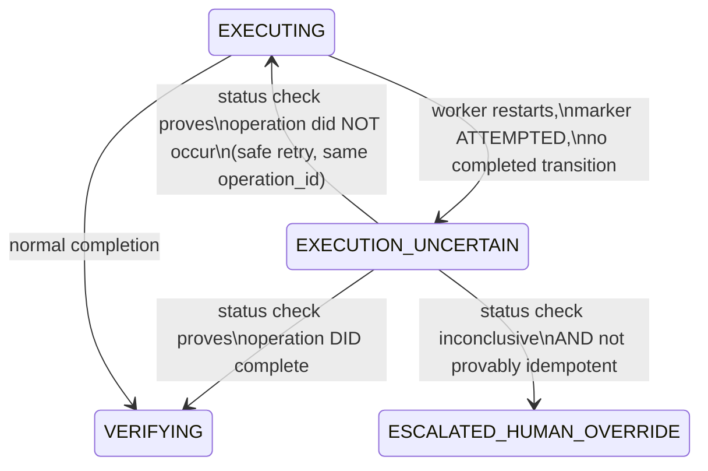
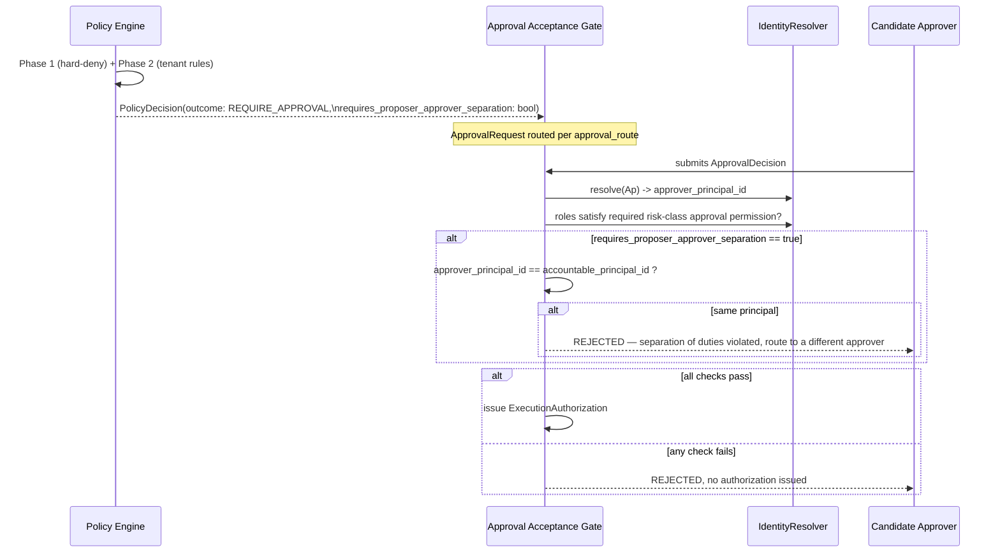
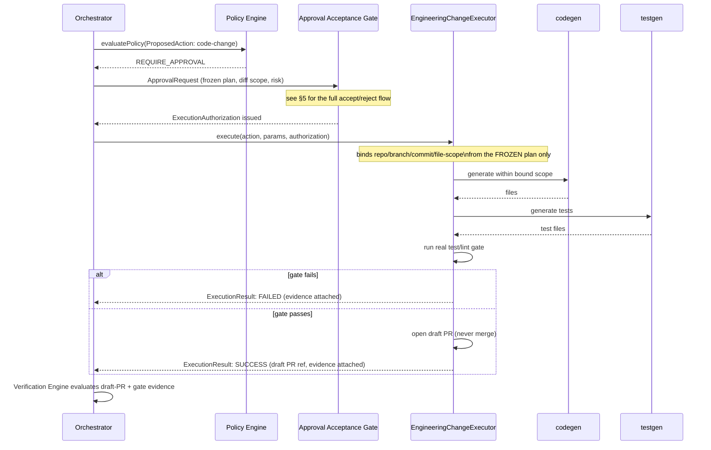
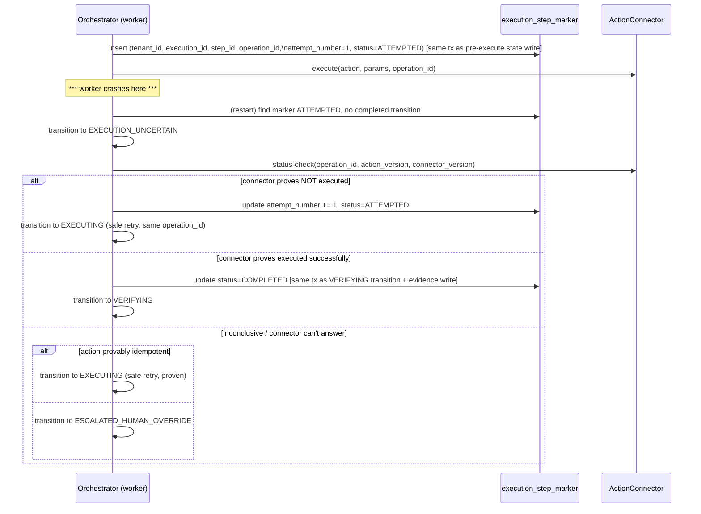

# LLD v1 — AOP-001

**Phase:** 2 (Design) · **Agent:** lld · **Status:** ACCEPTED
**Inputs:** 12 `ACCEPTED` ADRs (`pipeline/adr/`), `pipeline/requirements.md`
(Revision 2), spec §32's entity inventory. Only **additive** changes to
spec-defined contracts throughout, per ADR-001's established convention.

**Process correction, stated plainly:** the commit that introduced this
document's first draft said "APPROVED" while the document itself still said
"awaiting HIL gate" — a real inconsistency, correctly caught. That commit
was premature; the actual human gate for this design is the one this
revision is now presented for. Per direction, this is fixed going forward
via a follow-up commit, not by rewriting the prior commit's history.

## Revision history

- 2026-08-17 — Revision 1 (prematurely labeled `ACCEPTED`/"APPROVED" in the
  accompanying commit message — corrected below, not by rewriting that
  commit).
- 2026-08-17 — Revision 2: six blocking findings + six non-blocking
  corrections addressed in place — see per-section notes below. This is the
  version actually presented for gate approval.
- 2026-08-17 — **ACCEPTED** at HIL gate (product owner). Per
  `loop/agents/lld.md`'s versioning rule, immutable from this point — a
  future change is LLD-v2.md, not an in-place edit of this file.

---

## 0. Decision queue carried from ADR — resolved here

### OI-REQ-02 — `ContextPackage` shape

**Decision (unchanged):** No schema change to `ContextPackage`. Execution
History / Evaluation Results served as a derived, read-only
`EngineeringContextPackageView`, joined at read time by `execution_id` —
mirrors `Evidence`'s existing join-based relationship pattern (§4.6) rather
than introducing a new one.

### OI-REQ-10 — version-binding fields

**Decision (unchanged):** `connector_definition.definition_version: string`
and `action_execution.executor_build_hash: string`, both additive, both
populated at build/registration time, never computed at runtime.

---

## 1. ADR consequences carried into LLD constraints (mechanical gate 3)

| ADR | Consequence requiring follow-through | LLD constraint |
|---|---|---|
| 001 | Two fields (`reversible`/`compensation_class`) must stay consistent | `ActionConnector.validateAction()` runs the consistency check — tested by `test_actionDefinition_rejectsInconsistentReversibleAndCompensationClass()` |
| 001 | `rollback_action_ref` means different things per class | Documented per-class in the Zod schema JSDoc (§2) |
| 002 | Self-heal/real-test-gate logic must be shared, not duplicated | A shared `runRealTestGate()` module used by both the full Build loop and `EngineeringChangeExecutor` |
| 002 | Two orchestration paths need consistency tests | A shared contract test suite exercising both paths against the same fixture |
| 003 | Declarative rules less expressive than executable code | Rule-language grammar scoped explicitly — **still open, see OI-LLD-01 (§8), narrowed this revision to name exactly what it blocks** |
| 004 | `ActionConnector` needs an explicit idempotency contract per connector | `connector_definition.supports_correlation` + `is_idempotent` booleans (§2), required at registration |
| 004 | Marker needs a durability guarantee **and full operational semantics** | §2's `execution_step_marker` redesign (Revision 2 — see Finding 5) |
| 005 | Outbox relay is a new operational component | Flagged for a dedicated Build story + relay-lag metric — **now with a concrete default, see OI-LLD-02 (§8)** |
| 005 | Event consumers must tolerate at-least-once delivery | Consumers dedupe by the outbox's stable `event_id` (§2, Revision 2 — see Finding 6), never the incidental row `id` |
| 006 | `VerificationResult.checks[].name` needs a formal enum | Enum defined in §2 |
| 007 | More configuration surface (per-connector-instance reliability) | Field defined in §2 (Revision 2 — see Finding 2) |
| 008 | Policy Engine's evaluation-failure path needs explicit fail-closed behavior | Two-phase evaluation design, §3 |
| 008 | Hard-deny list must be enforced before approval-routing | Same design, §3 |
| 011 | Five retention classes need real default values **and an enforcement mechanism** | §2, Revision 2 — see Finding 3 |
| 011 | "Mandatory tenant decision before production onboarding" needs technical enforcement | Tenant activation gate, §2/§6 |
| 012 | More MVP-scope work than Revision 1 implied | `identity_principal` table + `IdentityResolver`, §2/§5 |
| 012 | Dev principals must be clearly labeled non-production | `is_development_principal` flag + activation-gate check |

---

## 2. Data model deltas

Additive only, against spec §32's table list.

### New tables

**`execution_step_marker`** — ADR-004's write-ahead marker.
*Revision 2: fully specified per review Finding 5 — Revision 1's version was
missing `tenant_id` (Finding 1) and left operational semantics implicit.*

```
execution_step_marker
  id                 -- internal PK, incidental
  tenant_id           -- NOT NULL — tenant isolation invariant (NFR-04)
  execution_id
  step_id
  operation_id        -- STABLE per (tenant_id, execution_id, step_id):
                       -- deterministically derived (hash of those three +
                       -- action_version), NOT regenerated per attempt.
                       -- Reused across retries so the connector can
                       -- recognize repeat attempts of the same logical
                       -- operation — this is what makes it a real
                       -- idempotency key, not just a log entry.
  action_ref
  action_version       -- binds the marker to the exact action definition
                        -- version attempted
  connector_ref
  connector_version     -- binds to the exact connector version, so a
                         -- later status-check targets the same connector
                         -- build that made the original attempt
  attempt_number         -- increments on each retry of the SAME
                          -- operation_id; starts at 1
  status                 -- ATTEMPTED | COMPLETED
  created_at
  updated_at
  completed_at?

  UNIQUE (tenant_id, execution_id, step_id, operation_id)
```

**Completion transaction semantics:** `status → COMPLETED` is written in the
*same transaction* as the `ExecutionState` transition to `VERIFYING` and the
`Evidence` write — folded into ADR-005's same-transaction state+evidence
pattern, not a separate, untracked write.

**What happens when marker-completion persistence fails after confirmed
execution** (the residual crash window, per review Finding 5's last bullet):
this is exactly the scenario `EXECUTION_UNCERTAIN` (§4) already exists to
handle — no new mechanism needed, just stated explicitly: on restart the
marker still reads `ATTEMPTED` (the `COMPLETED` write never committed), the
orchestrator transitions to `EXECUTION_UNCERTAIN`, runs `status-check` using
the *same, reused* `operation_id` and the recorded `action_version`/
`connector_version`, the connector confirms success, and the orchestrator
transitions to `VERIFYING` — marking the marker `COMPLETED` in that same
transaction.

**`outbox_event`** — ADR-005's outbox.
*Revision 2: fully specified per review Finding 6 — Revision 1's version was
missing `tenant_id` (Finding 1) and was too thin to support real dedup,
ordering, or debugging.*

```
outbox_event
  id                  -- internal PK, incidental — NOT what consumers dedupe on
  tenant_id            -- NOT NULL — tenant isolation invariant
  event_id              -- stable UUID generated at insert time — THIS is
                         -- what consumers dedupe on
  execution_id
  event_type            -- e.g. "opc.matched", "execution.halted" (spec §22)
  aggregate_type         -- "execution" | "proposed_action" | "approval" | ...
  aggregate_id
  aggregate_version       -- the aggregate's revision at emission time —
                           -- lets consumers detect gaps/out-of-order delivery
  event_schema_version     -- versions the payload shape, independent of
                            -- aggregate_version
  payload
  available_at              -- when this event becomes eligible for relay
                             -- pickup (supports delayed emission; defaults
                             -- to created_at)
  created_at
  published_at?
  delivery_attempts
  last_error?

  UNIQUE (event_id)
  INDEX (tenant_id, available_at) WHERE published_at IS NULL   -- relay's poll query
```

**`identity_principal`** — ADR-012 (unchanged from Revision 1, already had `tenant_id`):

```
identity_principal
  id, tenant_id, display_name, roles: string[],
  is_development_principal: boolean, created_at
```

### Changed tables (additive fields only)

| Table | New field(s) | Why |
|---|---|---|
| `action_definition` | `compensation_class: REVERSIBLE\|COMPENSATABLE\|IRREVERSIBLE`, `risk_scoring_ref: string?` | ADR-001, ADR-003 |
| `proposed_action` | `risk_assessment.blast_radius` gains `environmental_criticality`, `compensation_class`, `data_sensitivity`, `customer_exposure` (JSON, alongside existing `scope`/`estimated_entities`); **`accountable_principal_id: string`** (Revision 2 — Finding 2, previously described in prose §5 but not persisted here) | ADR-003, ADR-012 |
| `action_execution` | `executor_build_hash: string` | OI-REQ-10 |
| `connector_definition` | `definition_version: string`, `supports_correlation: boolean`, `is_idempotent: boolean`; **`reliability_level: LOW\|MEDIUM\|HIGH\|AUTHORITATIVE`** (Revision 2 — Finding 2). **Design choice**: a mutable field directly on the row, not a separate `connector_reliability` table — each `connector_definition` row already is the specific `(tenant, definition, version)` combination ADR-007 keys reliability to, so a join buys nothing yet; revisit only if/when ADR-007's empirical evolution needs to historize reliability over time independent of version bumps. | OI-REQ-10, ADR-004, ADR-007 |
| `execution` | `state` enum gains `EXECUTION_UNCERTAIN` | ADR-004 / gate 5 |
| `evidence` | `retention_class` constrained to 5 named values; **`retention_expires_at: timestamp`, `retention_policy_version: string`, `legal_hold: boolean` (default `false`)** (Revision 2 — Finding 3: a class name alone doesn't enforce anything; these three fields are what an actual deletion/archival job runs against) | ADR-011 |
| `policy_decision` | **`hard_deny_reason_code: HardDenyReasonCode?` (enum) + `hard_deny_detail: string?` (sanitized, human-readable, non-blocking correction)**, replacing the Revision 1 unconstrained string; **`requires_proposer_approver_separation: boolean`** (Revision 2 — Finding 2 + Finding 4: computed at policy-evaluation time, *consumed* later at the Approval Acceptance Gate, §5) | ADR-008, ADR-012 |
| `tenant` | `retention_policy_confirmed_at: timestamp?`, `production_activated_at: timestamp?` | ADR-011, unified activation gate |
| `policy_definition` | each entry in the `rules[]` JSON array gains an optional `requires_proposer_approver_separation: boolean` (Revision 2 — Finding 2). **Not a new relational table** — `PolicyRule` is already schema-validated JSON per spec §16, this is one more field in that same schema. | ADR-012 |

### Enums newly formalized

```
VerificationResult.checks[].name (ADR-006):
  UNIT_TEST | INTEGRATION_TEST | STATIC_ANALYSIS | POLICY_CHECK |
  ROLE_SEPARATED_REVIEW | PRODUCTION_EVIDENCE | PREFLIGHT_DRIFT_CHECK

HardDenyReasonCode (ADR-008, Revision 2 — Finding, non-blocking):
  UNREGISTERED_ACTION | TENANT_MISMATCH | EXPIRED_AUTHORIZATION |
  PROHIBITED_ENVIRONMENT | MISSING_REQUIRED_EVIDENCE |
  KILL_SWITCH_ACTIVE | IMMUTABLE_POLICY_VIOLATION |
  POLICY_EVALUATION_FAILED
```

All tenant-scoped tables — including both new ones — carry `tenant_id`
as the leading column in every unique constraint and lookup index, per
CONTEXT.md RULE 4 and the review's Finding 1.

---

## 3. Gate 4 — ADR-008 hard-deny rules as non-bypassable invariants

```
evaluatePolicy(proposedAction):
  # PHASE 1 — fixed, non-tenant-configurable, cannot be skipped
  for check in HARD_DENY_CHECKS:        # the 7 conditions from ADR-008
    if check.fails(proposedAction):
      return DENY(hard_deny_reason_code: check.code, hard_deny_detail: check.sanitizedDetail())

  # PHASE 2 — tenant PolicyRule evaluation (spec §16)
  ...evaluate tenant rules, ALLOW | REQUIRE_APPROVAL | DENY...
  # if REQUIRE_APPROVAL, also set: requires_proposer_approver_separation
  # from any matched rule that sets it (Revision 2 — see §5's corrected flow)

  # evaluation failure at ANY point in either phase:
  on exception/timeout/malformed-rule/missing-input:
    return DENY(hard_deny_reason_code: POLICY_EVALUATION_FAILED)
```

`HARD_DENY_CHECKS` is a fixed list in code
(`packages/policy-engine/src/hard-deny.ts`), not loaded from tenant config —
no tenant policy authoring mistake can disable it.

**Non-blocking correction applied:** `hard_deny_reason` is now a structured
`{code, detail?}` pair (see §2's enum), not an unconstrained string — a
free-text reason risks leaking internal detail into a field that may
surface on a tenant-facing dashboard; the code is safe to display always,
the detail is explicitly sanitized before being set.

**Required test** (unchanged): `test_hardDeny_cannotBeOverriddenByAnyPolicyRule()`.

---

## 4. Gate 5 — ADR-004's uncertain-outcome state, explicit in the execution-state model

Unchanged from Revision 1 — this section wasn't part of the review's
findings:



The status check in the second transition reuses the *same* `operation_id`
recorded on the marker (§2) — this is why `operation_id` had to be stable
and reused across attempts, not regenerated per retry.

---

## 5. Gate 6 — identity model, proposer/approver attribution, and the corrected separation-of-duties flow

**Blocking correction (Finding 4):** Revision 1 placed the separation-of-
duties check inside Policy Engine Phase 2, at initial policy evaluation —
but at that point **no approver has been chosen yet**; `REQUIRE_APPROVAL`
is an outcome, not an identity. The check cannot run where Revision 1 put
it. Corrected flow:



**The policy rule determines *whether* separation is required (an output
of Phase 2, carried on `PolicyDecision.requires_proposer_approver_separation`);
the Approval Acceptance Gate enforces it against the *actual* resolved
approver identity, after that identity exists.** No `ExecutionAuthorization`
is issued until every check in this gate passes — this is a hard
precondition on the gate, not a warning.

**Attribution fields** (unchanged from Revision 1, now correctly persisted
per §2):
- `ProposedAction.accountable_principal_id` — resolved via `IdentityResolver`
  from `IncomingRequest.requester` (or an on-behalf-of context). Distinct
  from `generated_by.agent`/`model` (spec §4.3), which names the AI agent,
  not the accountable human/system principal.
- `ApprovalDecision.actor` — resolves through the same `IdentityResolver`.

This makes proposer/approver attribution real from day one, using
development principals (ADR-012) — not deferred alongside the external
provider integration.

---

## 6. API contracts (deltas only — spec's existing endpoints unchanged)

```http
# Internal — orchestrator to connector, not tenant-facing
POST /internal/connectors/{connector_ref}/status-check
  body: { operation_id, action_version, connector_version }
  -- ADR-004's mandatory status check on EXECUTION_UNCERTAIN; version
  -- fields let the connector reject a check against a build it doesn't
  -- recognize rather than guessing.

# New read endpoint — OI-REQ-02 resolution
GET /tenants/{tenantId}/executions/{executionId}/context-package/composite
  -- the EngineeringContextPackageView, read-only

# New — unifies ADR-011's and ADR-012's activation gates
POST /tenants/{tenantId}/onboarding/activate
  -- rejects unless retention_policy_confirmed_at is set AND no
  -- production-flagged execution path resolves through an
  -- is_development_principal identity

# New — Approval Acceptance Gate (Finding 4's corrected flow, §5)
POST /tenants/{tenantId}/approvals/{approvalId}/decision
  body: { decision, actor_ref, comment? }
  -- resolves actor_ref via IdentityResolver, runs the separation-of-duties
  -- check when PolicyDecision.requires_proposer_approver_separation is
  -- true, issues ExecutionAuthorization only if every check passes
```

All other endpoints (§3.1 config service, §7A halt, existing §18 approval
shape) are unchanged from spec — referenced, not restated.

---

## 7. Sequence flows

### 7.1 Engineering-change action, via `EngineeringChangeExecutor` (ADR-002)

Unchanged from Revision 1:



### 7.2 Crash recovery into `EXECUTION_UNCERTAIN` (ADR-004)

*Revision 2: now shows `attempt_number` and the reused `operation_id`
explicitly (Finding 5).*



---

## 8. Open items still tracked

Resolved by this LLD: **OI-REQ-02, OI-REQ-10** (§0).

**Non-blocking correction applied (Story-Gen scope):** Revision 1 implied
`OI-CTX-01/02/04/05/06/07` broadly block Story Generation. That overstated
it. **Tenant facts don't block a tenant-neutral MVP story queue** — Story
Gen can and should produce the MVP queue (webhook trigger, one OPC matcher,
state machine, context assembly, policy, approval, a *simulated* action
connector, verification, evidence — per Requirements Revision 2's own MVP
classification) without knowing who Tenant #1 is. What these items actually
block is narrower: **selecting a real pilot ticket and building real
integrations** (a real context connector, a real action connector) —
Story Gen should sequence those stories as blocked, not the queue as a
whole.

Carried forward, scope corrected:
- `OI-CTX-01, 02, 04, 05, 06, 07` — block real-pilot/real-connector
  stories specifically, **not** MVP story-queue generation.
- `OI-CTX-03, 09, 10, 12` — architecture resolved by ADR; tenant fact
  still open, tracked for onboarding.
- `OI-CTX-11` — explicitly Post-MVP.

New, surfaced while writing this LLD, scope corrected per review:

- **OI-LLD-01**: the declarative scoring rule-language grammar (ADR-003) is
  referenced but not fully specified. **Blocks implementation of the
  scoring engine (F-19/F-03's risk-scoring path) specifically — does
  not block MVP story-queue generation**, since F-19 is Post-MVP.
- **OI-LLD-02**: outbox relay-lag alerting. **Reframed as a Build story,
  not an open blocker** — ship with a configurable default alert
  threshold (5 minutes, tenant-overridable) rather than leaving the
  number unspecified.

---

## 9. Validation

- [x] Versioned (v1, Revision 2); all OIs carried and tracked.
- [x] Every schema/contract element traces to an ADR or requirement (§1, inline throughout §2-5).
- [x] No code — design only.
- [x] Gate 3 (ADR consequences → LLD constraints): §1.
- [x] Gate 4 (ADR-008 hard-deny as non-bypassable invariant): §3, with `hard_deny_reason` now structured.
- [x] Gate 5 (ADR-004 uncertain-outcome state, explicit): §4.
- [x] Gate 6 (ADR-012 proposer/approver attribution, correctly sequenced): §5.
- [x] Finding 1 (tenant isolation on new tables): §2 — both new tables now carry `tenant_id` as the leading key.
- [x] Finding 2 (three unpersisted fields): §2 — all three now have a table/field home.
- [x] Finding 3 (retention enforceability): §2 — `retention_expires_at` + `retention_policy_version` + `legal_hold` added.
- [x] Finding 4 (separation-of-duties timing): §5 — moved to the Approval Acceptance Gate, after approver identity resolves.
- [x] Finding 5 (marker underspecification): §2 — full field list, uniqueness constraint, transaction semantics, crash-window resolution.
- [x] Finding 6 (outbox contract thinness): §2 — full field list per review's exact list.
- [x] Non-blocking: `hard_deny_reason` structured (§2/§3); commit-message/status mismatch corrected (this header + revision history); ADR README staleness corrected (separate commit, see below); Story-Gen blocking scope corrected (§8); OI-LLD-01/02 scope narrowed (§8).
